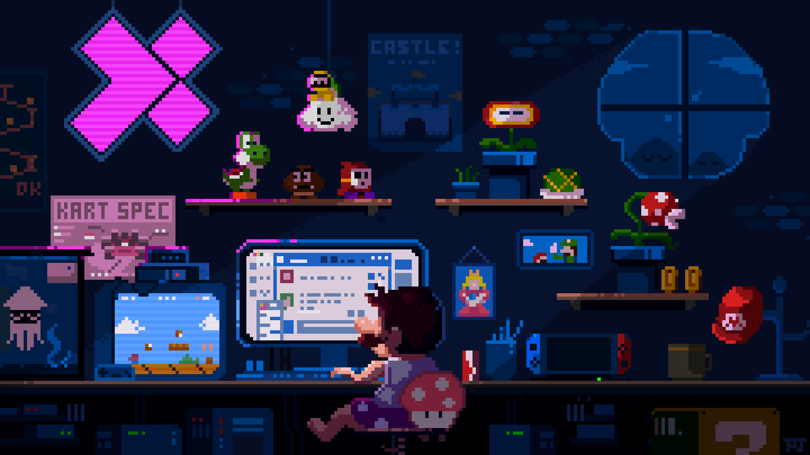

    

# 

 

 

<h2 align="center" >❖ About me ❖ </h2>  

<!--  apos formatar no ps com margins transparentes colocar aqui.  -->

 

Bacharel em Sistemas de Informação, desenvolvedor Full Stack com foco em 
C# | .NET | React, com experiência em análise de sistemas e Cloud Computing com AWS. 
Conquistei a certificação AWS Certified Cloud Practitioner (CLF-C02) e estou em 
constante evolução, buscando construir soluções que integrem desenvolvimento de 
software, análise de sistemas e infraestrutura em nuvem.

-  Meu objetivo de longo prazo é consolidade minha carreria em DevOps Engineering 
-  Tecnologias: HTML5 | CSS3 | JavaScript| Typescript | React | C# | ASP.NET Core | SQL Server | AWS | Linux | Windows. 
-  Apaixonado por aprender e construir soluções reais que unam desenvolvimento, cloud e boas práticas de engenharia. 

 

<h2 align="center" >❖ Connect with me! ❖</h2>
 

&nbsp;&nbsp;
&nbsp;&nbsp;

 

<h2 align="center" >❖ My Skills ❖ </h2>
 

            
        

   
  <h2>❖ GitHub Stats ❖</h2>
   
  

  

🔧 Stats gerados com [github-readme-stats](https://github.com/anuraghazra/github-readme-stats) por [Anurag Hazra](https://github.com/anuraghazra)

#
 

<picture >
  <source media="(prefers-color-scheme: dark)" srcset="https://raw.githubusercontent.com/Dev-Phap/dev-phap/gh-pages/github-contribution-grid-snake-dark.svg">
  <source media="(prefers-color-scheme: light)" srcset="https://raw.githubusercontent.com/Dev-Phap/dev-phap/gh-pages/github-contribution-grid-snake.svg">
  
</picture>

